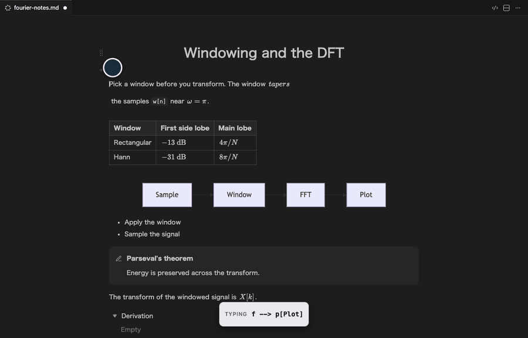

# Blocks

Every paragraph, heading, list item, table, image paragraph and other block has a handle that appears on its left when you point at it. The handle is how you move a block, select it, and reach the actions that work on whole blocks.

## The block menu

Click the handle, or right-click it, to open the block menu:

| Item | What it does |
| --- | --- |
| Turn into › | Converts the block, keeping its text — the same list as the [slash menu](slash-menu.md)'s **Turn into** |
| Insert above / Insert below | Opens an empty line above or below the block, ready for typing |
| Cut, Copy | Puts the block on the clipboard — formatted for apps that accept rich text, as Markdown for plain-text editors |
| Duplicate | Copies the block directly below itself |
| Edit Markdown | Opens the block's Markdown source with a live preview; **Apply** (`⌘↩`) writes it back, **Cancel** leaves the block as it was |
| Delete | Removes the block |

To open the same menu from the keyboard, press `⌃↩` (`Ctrl+Enter` on Windows and Linux). `Shift+F10` and the Context Menu key work too.

## Moving blocks

Drag a handle to move its block. A line shows where it will land. `⌥↑` and `⌥↓` (`Alt+↑` / `Alt+↓`) move the block the caret is in, or every selected block, one step up or down.

## Selecting several blocks

- **With the mouse** — start a drag in the margin to the left of the text and sweep over the blocks you want. Drag any handle inside the selection to move them all together.
- **With the keyboard** — press `Esc` while typing to select the block the caret is in. `↑` and `↓` move to the neighbouring block, and `Shift+↑` / `Shift+↓` extend the selection. `Enter` puts the caret back into the text, and `Esc` again clears the selection.

With blocks selected, `Delete` or Backspace removes them, `⌘C` and `⌘X` copy and cut them, and the block menu acts on all of them at once. A selection is always one continuous range; you cannot pick blocks that are not next to each other.

## Pasting

`⌘V` keeps the formatting of what you copied, whether it came from Olive, a web page or another editor. `⇧⌘V` (`Ctrl+Shift+V`) pastes plain text only.

---

Back to the [contents](README.md).
