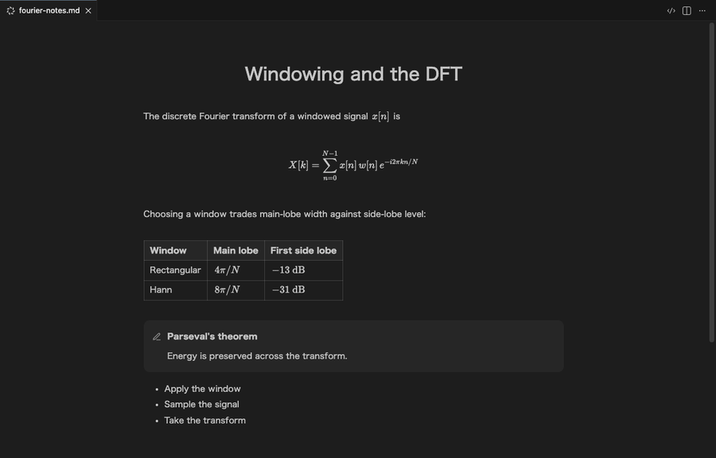

# Math

Olive renders TeX math with KaTeX and keeps it rendered while you edit it. The document never falls back to showing `$…$`; you edit the LaTeX in a small field while the formula on the page updates as you type. In the file, math stays ordinary Markdown math; see [how math is written in the file](#how-math-is-written-in-the-file).

## Inline math

There are four ways to start an inline formula:

- type `$x$` — it converts when you type the closing `$`
- type `$$` — an empty formula opens, ready for LaTeX, anywhere in a line
- select text and press `$` to wrap it
- press `⇧⌘E` (`Ctrl+Shift+E`), or use the **Inline math** button on the selection toolbar

## Editing a formula

Click a formula, or move onto it with the arrow keys. A field opens with its LaTeX selected, and the formula on the page re-renders with every keystroke.

- `Enter`, or clicking elsewhere, keeps the change.
- `Esc` discards it. A formula you just created and leave empty is removed.
- A plain `$` typed inside an inline formula is saved as `\$`, since a bare `$` would end the formula. The field says so while one is there.

## How math is written in the file

Inline math is written as `$…$`. A formula that contains a `$` of its own is written in GitHub's form, `` $`…`$ ``, which Olive also reads. Whichever form a formula was already written in is kept.

If editing leaves two inline formulas directly side by side, Olive puts a space between them. Without one, other Markdown tools disagree about where the first formula ends.

## Display math

Use `/math` (also `/equation`, `/tex` or `/latex`) for a display formula on its own line. On a line that already holds a formula, `/math` turns that line into a display block.

A display block is edited where it stands: click it, or select it and press `Enter`, and the source opens inside the block with a live preview beneath it. Confirming an empty source removes the block. In the file it is written as a `$$` block.

---

Back to the [contents](README.md).
