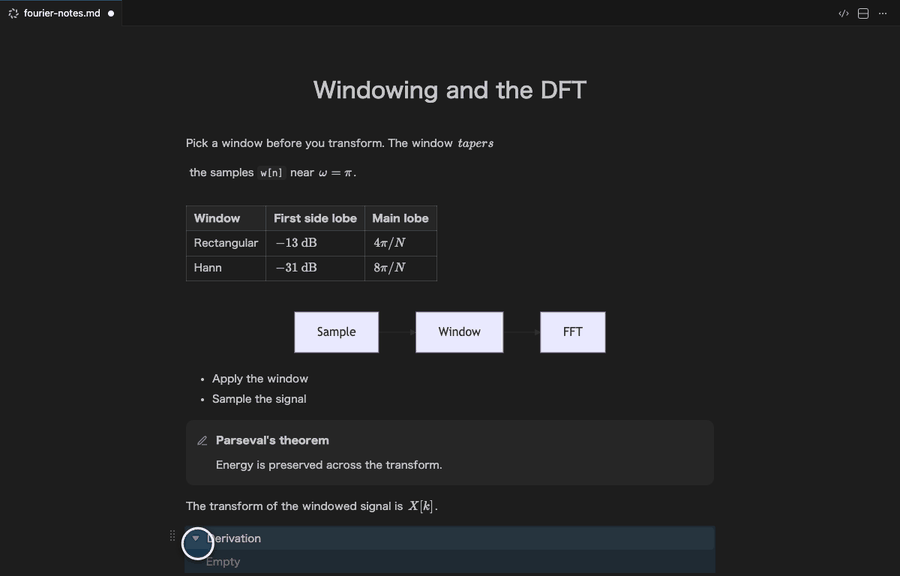

# Code blocks, tables, callouts, toggles and diagrams

These blocks are shown the way they will look, and you edit them in place. In the file they stay ordinary Markdown.

## Code blocks

Start one with ```` ``` ```` (or `~~~`) at the start of a line, optionally followed by a language name, or use `/code`. Code is highlighted for the language shown in the block's label; click the label to pick or type another language. The **Copy** button copies the code as plain text.

## Tables

`/table` inserts a two-column table with a header row. `Tab` and `Shift+Tab` move between cells, and `Tab` in the last cell adds a new row.

Point at a cell to reveal two small grips: one above its column and one to the left of its row.

- **Click a grip** to select the whole row or column and open its menu.
- **Drag a grip** to move the row or column. The header row stays where it is.
- **Right-click** a cell for the same actions.

| Action | Notes |
| --- | --- |
| Insert row before / after, Insert column before / after | |
| Move row up / down, Move column left / right | also possible by dragging a grip |
| Duplicate row, Duplicate column | |
| Column alignment: Default, Left, Center, Right | written as `---`, `:---`, `:---:` and `---:` |
| Reformat table | rewrites the table's Markdown as tidy `\| a \| b \|` rows |
| Delete row, Delete column | |

Only the actions that apply are listed — a first row cannot move up, for example. The same commands are in the [slash menu](slash-menu.md) when you type `/` inside a cell.

## Callouts

A callout is a quote with a type marker, as in GitHub alerts and Obsidian callouts:

```md
> [!tip] Optional title
> Text of the callout.
```

Type `> [!note] ` at the start of a line, or use `/callout`. Any type name works and is kept as you typed it (`[!WARNING]` stays `[!WARNING]` in the file). Olive gives its own icon and colour to the GitHub types — `note`, `tip`, `important`, `warning`, `caution` — and to the Obsidian types such as `info`, `todo`, `success`, `question`, `danger`, `bug` and `quote`. Mathematical types — `theorem`, `definition`, `lemma`, `proposition`, `corollary`, `example`, `proof`, `axiom`, `conjecture`, `remark`, `exercise` — are shown with their name and no icon. An unknown type gets a plain callout.

**Edit callout…** — from the **…** button in the callout's header, or `/edit` inside the callout — sets its type, title and folding. The title field is ready for typing, so you can name a callout without the mouse. **Add title** and **Remove title** in the slash menu do just that, and an existing title is edited by clicking it.

### Folding

A callout can be foldable: add `+` (open) or `-` (collapsed) after the closing `]`, or choose **Expanded** or **Collapsed** under **Edit callout…**. Click the arrow beside the title, or the callout's icon, to open or close it; clicking the title itself edits it. Typing `> [!tip]- ` starts a collapsed callout and opens its title for typing, since the title is all a collapsed callout shows.

## Toggles

`/toggle` inserts a toggle: a title line with content that opens and closes. In the file a toggle is an HTML `<details>` block with a `<summary>`, which GitHub and most Markdown viewers display the same way. Click the arrow beside the title to open or close it, and click the title to edit it.

## Mermaid diagrams

`/mermaid` (or `/diagram`) creates a Mermaid diagram. Click the rendered diagram to edit its source; the diagram updates as you type. A diagram with a syntax error keeps its source visible so you can fix it.



---

Back to the [contents](README.md).
