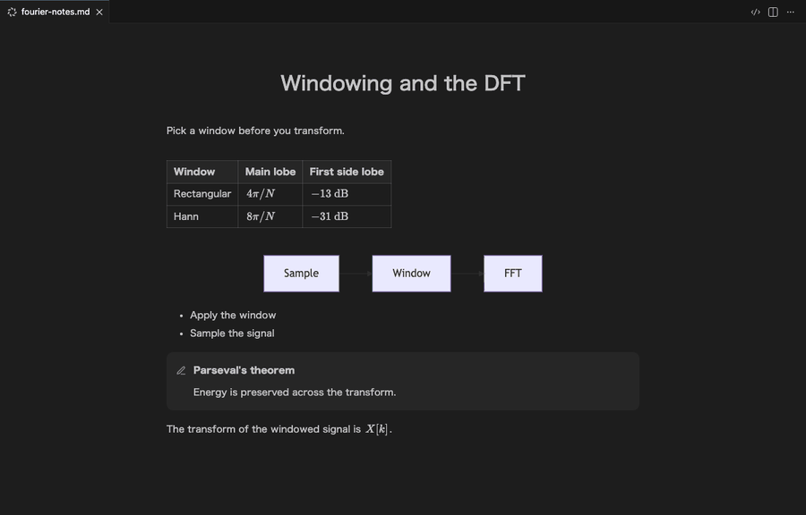

# Typing Markdown

Olive turns Markdown into formatting while you type. Inline patterns convert the moment you finish them, and block patterns convert at the start of a line when you type the space that follows them. The markers themselves — `**`, `#`, `$` — never come back, not even on the line you are editing.



## Inline formatting

| Type | Result |
| --- | --- |
| `**bold**` or `__bold__` | bold |
| `*italic*` or `_italic_` | italic |
| `~~strikethrough~~` | strikethrough |
| `==highlight==` | highlight |
| `` `code` `` | inline code |
| `$x$` | inline math |
| `$$` | an empty inline formula, ready to edit |
| `[^label]` followed by the next character | footnote reference |

`*`, `~~`, `==` and `` ` `` convert anywhere in a line, including directly after a Japanese character or any other letter. `_` and `__` follow CommonMark and convert only at the start of a line or after a space, so `snake_case_name` is left alone.

## Blocks at the start of a line

| Type | Result |
| --- | --- |
| `# ` to `###### ` | Heading 1–6 |
| `- `, `* `, `+ ` | Bulleted list |
| `1. ` | Numbered list |
| `[ ] ` or `[x] ` inside a list item | Task list item |
| `> ` | Quote |
| `> [!note] `, `> [!warning] `, … at the start of a quote | Callout |
| ```` ```lang ```` or `~~~lang` | Code block |
| `---`, `*** `, `___ ` | Divider |
| `[^label]: ` | Footnote definition |

`---` converts on its own; `*** ` and `___ ` need the trailing space. Callouts are described in [Tables, callouts, toggles and diagrams](tables-callouts-diagrams.md#callouts), and footnotes in [Links and footnotes](links.md#footnotes).

## Keeping what you typed

To keep the characters instead of the formatting, press Undo (`⌘Z`, or `Ctrl+Z` on Windows and Linux) or Backspace immediately after a conversion. The literal characters come back. Undo again to remove what you typed, or Redo to convert it again.

## Formatting a selection

Select text to bring up a toolbar with bold, italic, strikethrough, inline code, link and inline math. The usual shortcuts work as well — `⌘B`, `⌘I`, `⌘E` for code, `⌘K` for a link and `⇧⌘E` for inline math; the full list is in [Keyboard shortcuts](keyboard-shortcuts.md).

## Japanese, Chinese and Korean text

Patterns such as `**bold**` and `$math$` convert right after a Japanese, Chinese or Korean character with no space in between, and nothing converts while your input method is still composing.

## Line breaks

`Enter` starts a new paragraph or list item. `Shift+Enter` inserts a line break inside the same paragraph.

---

Back to the [contents](README.md).
