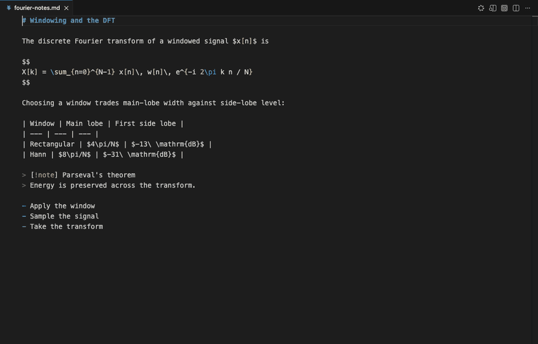

# Olive for Visual Studio Code

The Olive extension opens Markdown files in a visual editor inside VS Code. Saving, history, Undo and Redo, Git and conflict resolution all stay VS Code's own; Olive changes only how the file looks while you edit it. It needs VS Code 1.95 or later.

## Opening a file in Olive

Olive does not take over `.md` files. VS Code's text editor stays the default, and you open a file in Olive when you want to:

- click the Olive icon on the editor title bar while a Markdown file is open
- right-click a `.md` file in the Explorer and choose **Open in Olive**
- choose **Reopen Editor With…** → **Olive**
- on recent VS Code versions, pick **Olive** from the editor type dropdown at the right end of the breadcrumb bar
- run **Open in Olive** from the Command Palette

On recent VS Code versions this also works for a new, unsaved buffer set to Markdown.



### Making Olive the default

To open every `.md` file in Olive, add this to your settings:

```json
"workbench.editorAssociations": {
  "*.md": "olive.markdown"
}
```

On recent VS Code versions the editor type dropdown offers **Set Default for '\*.md'**, which writes the same setting. A workspace setting overrides your user setting, so check both if it has no effect.

### Back to the Markdown source

Run **Olive: Open as Markdown Source**, or use the code icon on the editor title bar. Switching either way keeps unsaved changes.

### Source and Olive side by side

Open the file in Olive and in the text editor in two split editors, then click the sync icon on the editor title bar, or run **Olive: Toggle Scroll Sync with Text Editor**. Scrolling either one then scrolls the other to the same place. The setting `olive.syncScrollWithTextEditor` remembers your choice.

When something outside Olive changes the file — a coding agent, a Git checkout, the text editor beside it — the Olive view follows right away.

## The Olive Outline

While an Olive editor is active, the **Olive Outline** view in the Explorer lists the note's headings. Click one to jump to it. Right-click a heading to **Promote Section** or **Demote Section**, **Move Section Up** or **Move Section Down**, or **Select Section**. The same commands are in the Command Palette and act on the section the caret is in.

## Commands and settings

Olive's commands appear in the Command Palette while an Olive editor is active, and its editing commands can be rebound in the Keyboard Shortcuts editor; see [Keyboard shortcuts](keyboard-shortcuts.md). Exporting is described in [Export](export.md).

| Setting | What it does |
| --- | --- |
| `olive.syncScrollWithTextEditor` | Scroll Olive and the text editor together when both show the same file |
| `olive.export.includeSource` | What **Export as HTML** offers the reader: the Markdown source (`markdown`, the default), a `.zip` with the images (`archive`), or nothing (`none`) |
| `olive.pdf.executablePath` | The Chromium-based browser **Export as PDF** uses, when Olive does not find one itself |

## Appearance

Olive follows your VS Code color theme, light or dark, with no setup.

## Where the extension does not run

- **Untrusted workspaces** (Restricted Mode) and **virtual workspaces** — Olive is disabled in both, and VS Code hides it from **Reopen Editor With…**.
- **Remote, SSH, WSL and Dev Containers** — untested. It may work, but nothing has been verified.

If Olive is missing or a file still opens as text after you trust the folder, close the tab and open the file again; see [Troubleshooting](troubleshooting.md#i-trusted-the-folder-but-the-file-still-opens-as-plain-text).

---

Back to the [contents](README.md).
